# 艺镜剪辑 · YiJing AI Editor

> **一款完全在本机运行的开源桌面视频剪辑器** —— Electron + React + 本机 ffmpeg。
> 从导入素材、多轨剪辑、调色、字幕、特效，到导出成片，整条链路都在你自己的电脑上完成：
> **不联网、不上传素材、没有账号体系、没有任何收费入口。**
>
> 它还内置了一个 **MCP 服务端**，可以被 [艺镜·镜枢](https://github.com/zhanfanghou-create/YJAI-yegin-releases)
> 这类 AI 智能体直接驱动 —— 智能体给出剪辑方案，软件自动落地成草稿并导出成片。

<p align="center">
  <a href="https://github.com/zhanfanghou-create/yijing-ai-editor/releases/latest"><b>▶ 下载 Windows 版（免安装 · 约 151 MB）</b></a>
</p>

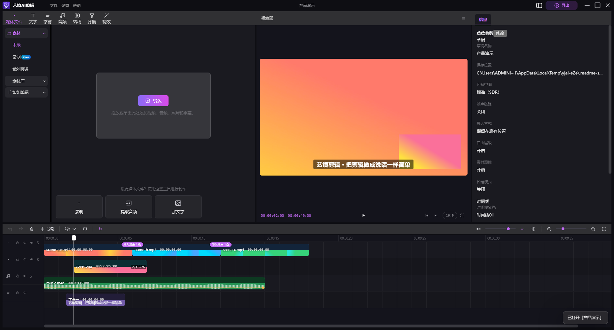

[](./LICENSE)
[](https://github.com/zhanfanghou-create/yijing-ai-editor/releases)
[](#下载与安装)
[](https://www.electronjs.org/)
[](https://nodejs.org/)
[](#智能剪辑内置-mcp-服务)

---

## 目录

- [这是什么](#这是什么)
- [界面截图](#界面截图)
- [功能特性](#功能特性)
- [下载与安装](#下载与安装)
- [与艺镜·镜枢配合](#与艺镜镜枢配合)
- [智能剪辑：内置 MCP 服务](#智能剪辑内置-mcp-服务)
- [从源码构建](#从源码构建)
- [使用说明](#使用说明)
- [快捷键](#快捷键)
- [关于 ffmpeg](#关于-ffmpeg)
- [目录结构](#目录结构)
- [验证与闸门](#验证与闸门)
- [素材与版权](#素材与版权)
- [第三方组件](#第三方组件)
- [常见问题](#常见问题)
- [许可证](#许可证)

---

## 这是什么

**艺镜剪辑**是一款**纯本地**的桌面视频剪辑器。它把「导入 → 剪辑 → 调色 → 加字幕 → 加特效 → 导出」
这条完整的创作链路整条放在一台电脑上，不依赖任何后端服务：

|  |  |
| --- | --- |
| **不联网** | 应用没有任何对外网络请求，也没有遥测、埋点或更新检查。 |
| **不上传** | 素材始终留在你自己的磁盘上，成片直接写到你指定的目录。 |
| **不要账号** | 没有注册、没有授权、没有账号体系，装完就能用。 |
| **不收费** | 没有任何付费入口，也没有功能解锁墙，全部能力开箱即用。 |

### 它面向谁

- **想在本机剪片、又不愿意把素材传上云的人**：素材不出本机是硬需求；
- **要把剪辑接进自动化流程的人**：内置 MCP 服务端，AI 智能体可以直接调用它建草稿、加片段、导出；
- **想读源码 / 二次开发的人**：全部代码开源，纯函数真源集中在 `src/shared/`，没有黑箱。

### 它和谁一起用

艺镜剪辑既**可以单独使用**（当作一个普通的本地剪辑软件），也可以作为**艺镜·镜枢**的
「剪辑手」—— 镜枢负责理解与决策，剪辑器负责落地成片。两者通过 **MCP** 通信，
装在同一台机器上即可自动对接，详见 [与艺镜·镜枢配合](#与艺镜镜枢配合)。

### 它能做什么

| 能力 | 说明 |
| --- | --- |
| 素材管理 | 导入本机视频 / 音频 / 图片，素材库按类型筛选；支持拖拽入轨 |
| 多轨剪辑 | 视频轨、叠加轨（画中画）、音频轨、文字轨；拖动 / 两端修剪 / 播放头分割 / 吸附 |
| 轨道状态 | 每条轨道可**隐藏 / 静音 / 锁定 / 独奏**，预览与导出走同一套判定 |
| 片段操作 | 停用（可逆、不进成片）、替换素材（换源不换起点）、右键菜单 |
| 转场 | 叠化、模糊、故障、运镜、扭曲、3D、光效… 分组素材，预览与导出一致 |
| 滤镜 | 电影风格、复古、黑白、风景… 直接作用在预览与成片上 |
| 画面特效 | 闪光、故障、扫描线、漏光、暗角等帧特效，叠加在画面上 |
| 调节 / 美颜 | 亮度、对比度、饱和度、色温、色调、锐化、美颜档位；预览与导出同一条公式 |
| 位置 / 缩放 / 旋转 | 逐片段的位移、缩放、旋转，画中画同样支持 |
| 文字与字幕 | 文字、字幕轨、花字模板；样式可覆写（字号 / 颜色 / 描边 / 底色 / 位置） |
| 音频 | 从视频提取音轨（本机 ffmpeg）、背景音乐、音量与淡入淡出 |
| 真波形 | 音频轨与视频片段底部按真实 PCM 绘制波形，不是装饰 |
| 倍速 | 0.25×–4×，预览与成片速度一致（导出按倍速拆分 atempo 级） |
| 画面比例 | 1:1 / 1:2 / 3:4 / 9:16 / 16:9 / 4:3 / 2:1 共 7 档，裁切铺满、不留黑边 |
| 导出 | 调用本机 ffmpeg 合成成片：滤镜 / 转场 / 帧特效 / 字幕 / 画中画 / 音量 / 倍速全部进成片 |
| 草稿 | 自动保存，重启后自动恢复；可自定义分辨率、比例与保存位置 |
| 界面 | 四区工作台可拖拽伸缩、双击复位、方向键微调；22 个可自定义快捷键 |

### 它不做什么

- 不联网、不要账号、不采集任何数据；
- **没有模型推理、没有在线素材 / 模板下载** —— 这一类依赖外部服务，本版一律不含；
- 没有任何计费体系。

---

## 界面截图

> 以下截图取自**本仓库构建出的真实客户端**（Windows · 1920×1080）。演示草稿的素材由本机
> ffmpeg 现场生成，不涉及任何第三方素材。

### 创作中心（首页）


左侧是「创作视频」与「最近草稿」；中间是快速入口、七个剪辑工具的直达按钮，以及最近草稿列表
（显示片段数与总时长）。点「视频剪辑器」或任意一张草稿即可进入工作台。

### 工作台总览


四区布局：**左「功能分类」→ 中「素材 / 预览」→ 下「时间线」→ 右「属性检查器」**。
这张图里的草稿有 6 个片段：主轨三段视频（含两处叠化转场）、一个画中画、
一条带真实波形的配乐、一条字幕 —— 预览里同时能看到主画面、右下角的画中画与字幕叠加。

### 时间线与多轨

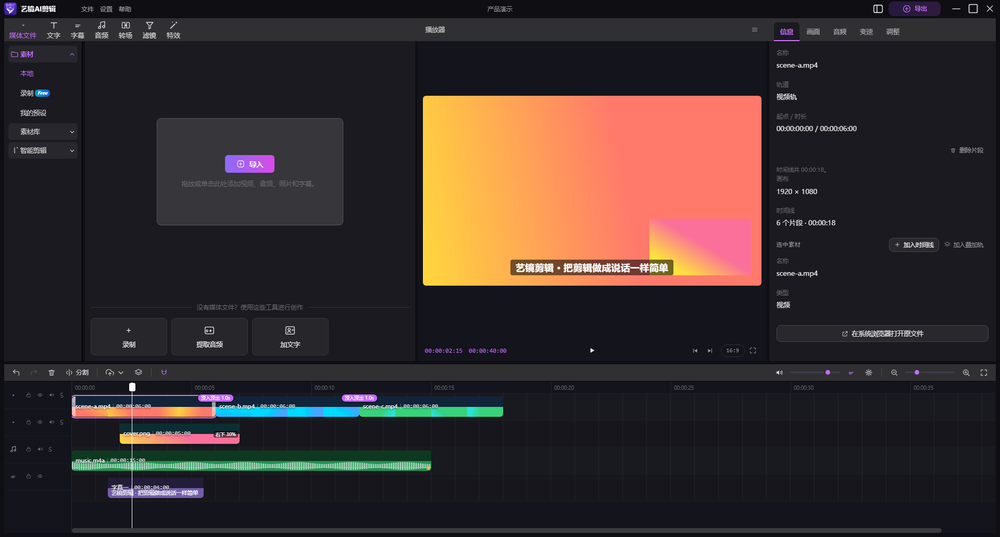

时间码是 `HH:MM:SS:FF` 的**帧号**格式（30fps）。音频片段上画的是由本机 ffmpeg 抽取 PCM
绘制的真实波形；视频片段底部也带一条内嵌波形，方便对轴。左侧每条轨道都有
隐藏 / 静音 / 锁定 / 独奏四个开关。

### 画面检查器

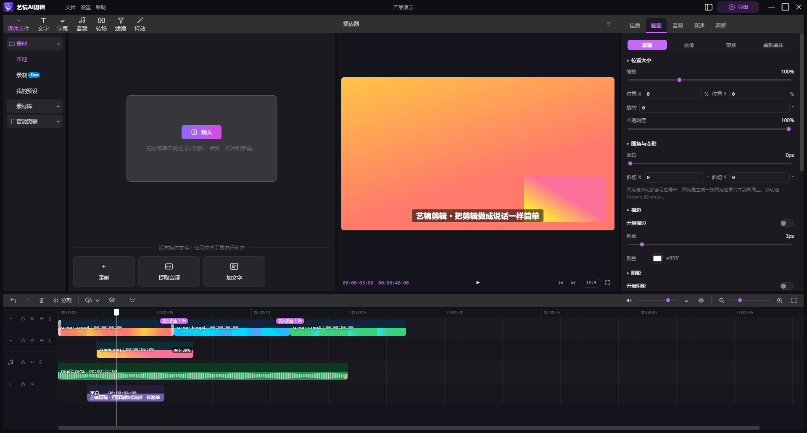

选中片段后，右栏是检查器，页签按片段类型给：**信息 / 画面 / 音频 / 变速 / 调整**
（音频轨只给前两项，字幕片段给「字幕」）。「画面」页管滤镜、转场、画面特效与不透明度。

### 调节与美颜

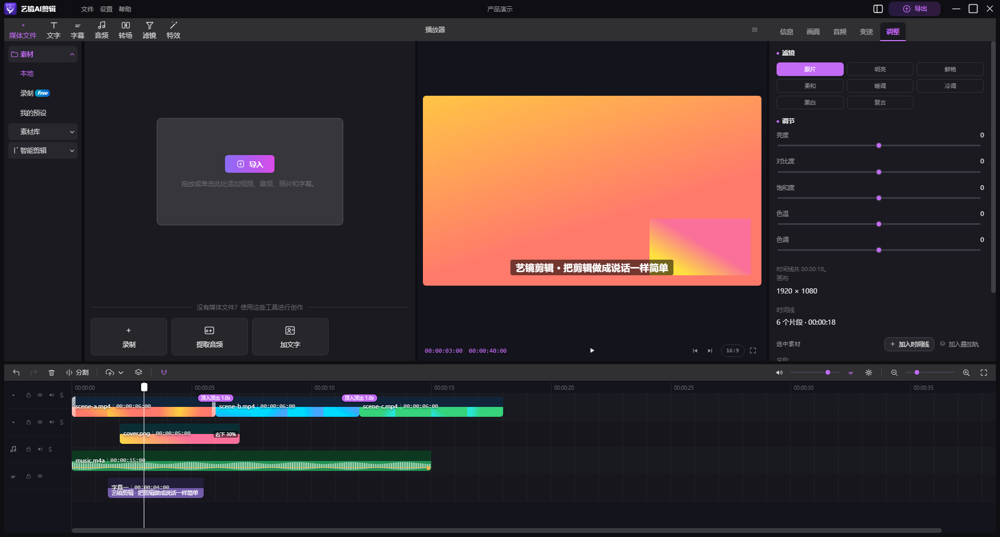

亮度、对比度、饱和度、色温、色调、锐化与美颜档位。**这一页的每一个滑杆都由同一份纯函数
同时驱动预览与导出**，不会出现「预览好看、成片不对」。

### 变速

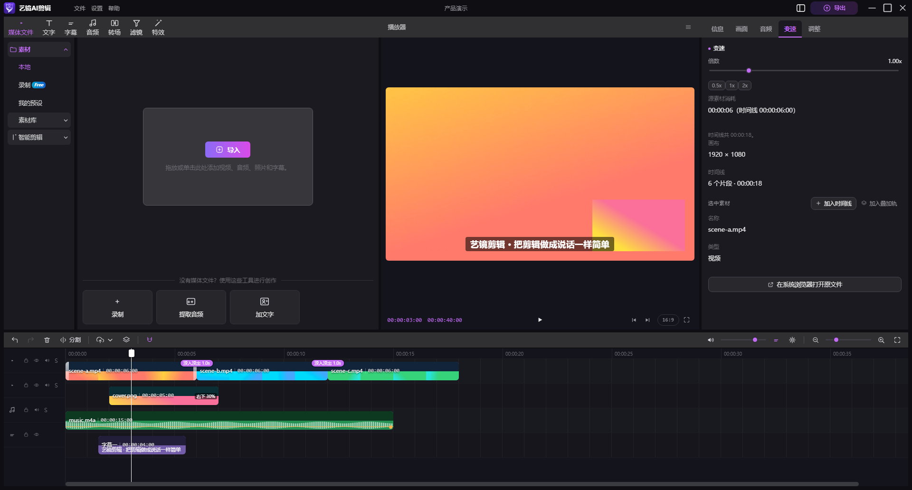

0.25×–4× 逐档可调。预览按同一倍率播放，导出按倍速拆分 `setpts` / `atempo`，
单级超出 0.5–2.0 会自动拆成多级，保证音画同步。

### 音频检查器

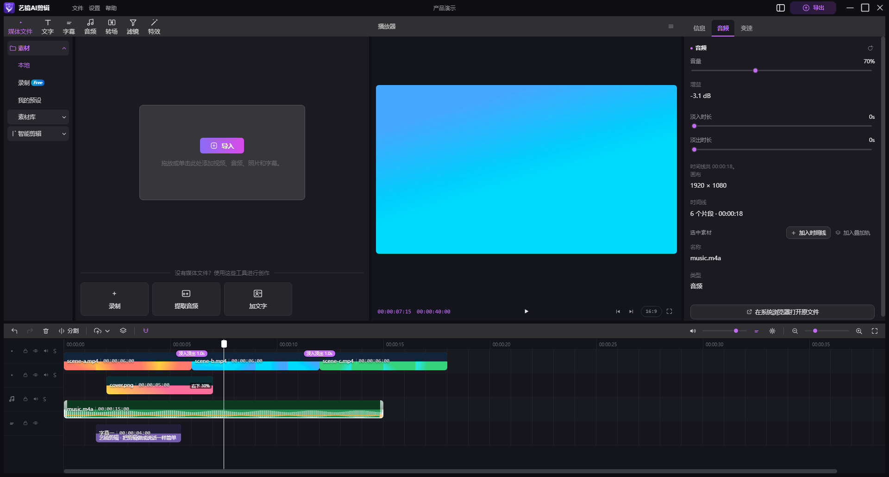

音量、淡入、淡出；「从视频提取音轨」也在这一链路里完成（本机 ffmpeg）。

### 字幕与花字

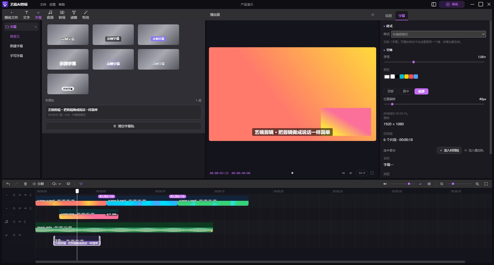

左栏是字幕样式库与手写字幕列表，右栏可覆写字号、颜色、描边、底色与位置偏移。
字幕的样式真源是一份纯函数，预览与 `main/subtitles.js` 的导出参数共用它。

### 画面特效

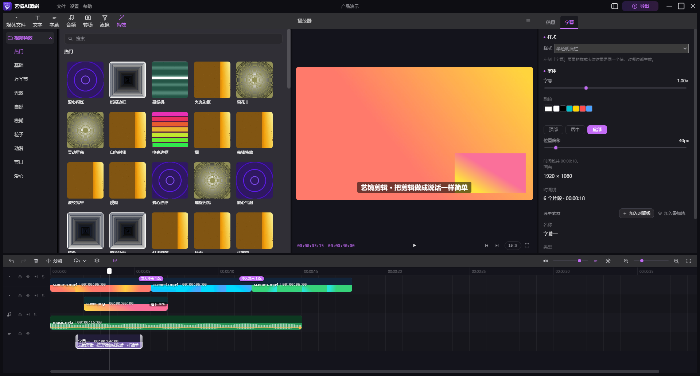

闪光、故障、扫描线、漏光、暗角、气泡等帧特效，按类别分组、卡片自带动态预览。
特效走独立叠加层，不会压掉已经在用的调色。

### 转场

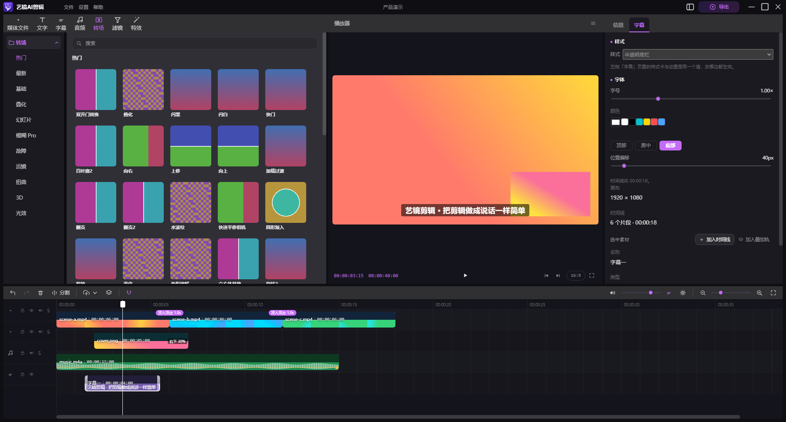

叠化、模糊、故障、运镜、扭曲、3D、光效等，按组排布；拖到两个片段之间即可。

### 滤镜

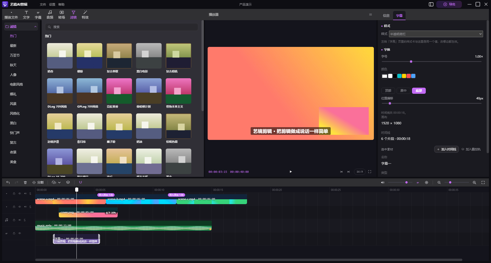

电影风格、复古、黑白、风景等调色预设，直接作用在预览与成片上。

### 画面比例

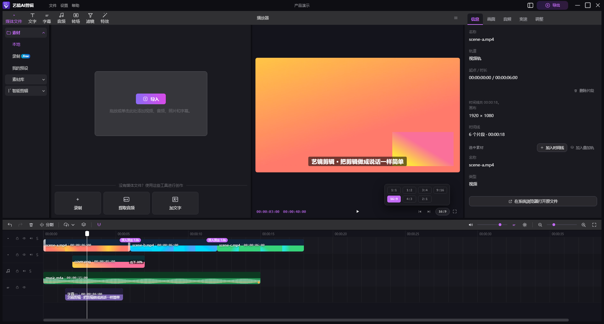

预览控制条右端的比例 chip，展开就是 7 档比例。比例语义是**裁切铺满**（不是加黑边），
并且跟着项目走、存进草稿。

### 音频库

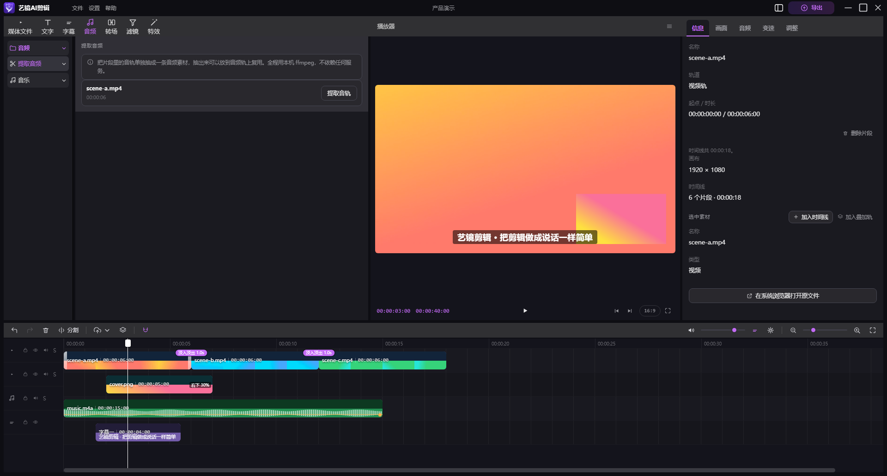

本地音乐的浏览与入轨，以及「从视频提取音轨」。

### 导出

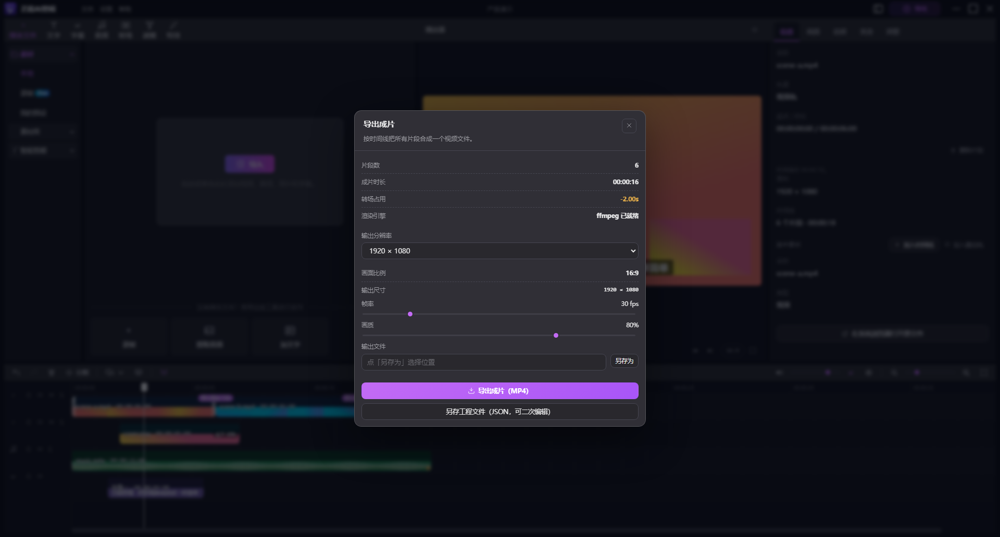

导出面板会列出片段数、成片时长、输出分辨率 / 比例 / 尺寸 / 帧率、速度与音量，
并显示画面引擎状态。点「导出成片」即调用本机 ffmpeg 合成 MP4；也可以「另存工程文件」。

---

## 功能特性

### 剪辑与时间线

- **四类轨道**：视频 / 叠加（画中画）/ 音频 / 文字，可自由增删与排序。
- **精确到帧**：时间码是 `HH:MM:SS:FF`（30fps）的帧号格式，播放条同时显示当前与总长。
- **吸附与缩放**：默认开启吸附；`Ctrl + 滚轮` 缩放时间线，也有快捷键与滑块。
- **分割与删除**：按钮、`Ctrl+B`、右键菜单三处走**同一条**分割路径，行为一致。

### 轨道状态（真源统一）

隐藏 / 静音 / 锁定 / 独奏四个状态由同一个真源决定，预览与导出**共用同一个出口**
（`effectiveClips`）。所以不会出现「界面显示已静音、导出却还有声音」这类不一致。

- **锁定**：禁止拖动 / 修剪 / 分割 / 删除 / 替换，但**不禁止播放**；
- **独奏**：其余能出声的轨道被静音（字幕轨不挂喇叭，因此不参与独奏）。

### 预览即所得

预览合成器对热点窗口预挂载解码器，跨片段接缝不换 `src`，因此播放不闪。
调色、美颜、位置旋转、字幕样式、画中画都是**同一份纯函数**同时驱动预览与导出 ——
不存在「预览好看、成片不对」的分叉。

### 导出

导出由本机 `ffmpeg` 完成，滤镜串、转场、帧特效、字幕、画中画、音量、倍速全部进成片；
画面比例决定输出尺寸与裁切方式。导出与界面预览走**同一条渲染管线**。

---

## 下载与安装

### 方式一：下载安装包（推荐）

<p align="center">
  <a href="https://github.com/zhanfanghou-create/yijing-ai-editor/releases/latest"><b>▶ 前往下载最新版（Windows x64 · 免安装）</b></a>
</p>

| 文件 | 平台 | 大小 |
| --- | --- | --- |
| [`YiJingAIEditor-Setup-Windows-x64.exe`](https://github.com/zhanfanghou-create/yijing-ai-editor/releases/latest/download/YiJingAIEditor-Setup-Windows-x64.exe) | Windows 10 / 11 (x64) | 约 151 MB |

- **免安装（portable）**：双击即用，不写注册表、不留残留；
- 首次运行会在 `%APPDATA%\YiJingAIEditor` 下建立数据目录（草稿、设置）；
- 每个 Release 都附有安装包的 **SHA-256**，可用 `certutil -hashfile <文件> SHA256` 校验。

> ⚠️ 安装包目前**未做代码签名**，Windows SmartScreen 可能提示「未知发布者」，
> 选择「更多信息 → 仍要运行」即可。

### 方式二：从源码构建

见 [从源码构建](#从源码构建)。

---

## 与艺镜·镜枢配合

[**艺镜·镜枢（Yegin）**](https://github.com/zhanfanghou-create/YJAI-yegin-releases) 是一个本地 AI 智能体
客户端。把镜枢和艺镜剪辑装在**同一台机器**上，两者就能自动对接：

1. **下载并安装镜枢**：到 [YJAI-yegin-releases](https://github.com/zhanfanghou-create/YJAI-yegin-releases/releases/latest)
   下载对应平台的安装包（Windows / macOS）。
2. **首次运行艺镜剪辑**：它会检测本机是否装有兼容的 MCP 宿主；若已安装，会**自动**把自己
   注册进去，**不需要任何额外配置**。
3. **在镜枢里直接下指令**：例如「把 `D:\素材` 里那三段视频剪成一个 9:16 的短片，
   加淡入淡出和字幕，导出到桌面」—— 镜枢会把方案落成草稿，剪辑器执行并导出成片。

两者的分工是：**镜枢负责理解与决策，艺镜剪辑负责落地与渲染**。产出的草稿是同一份格式 ——
智能体建好的草稿可以在界面里继续手动精修，界面里做好的草稿也能被智能体读取。

> 当然，**不装镜枢也完全可以**：艺镜剪辑本身就是一个完整的、可手动操作的剪辑器。

---

## 智能剪辑：内置 MCP 服务

本软件内置了一个 **MCP（Model Context Protocol）stdio 服务端**，任何支持 MCP 的 AI 智能体
都可以把它当作工具来调用，从而**自动完成剪辑**：建草稿 → 加片段 → 加字幕与特效 → 导出成片。

### 提供的工具

| 工具 | 作用 |
| --- | --- |
| `yijing_list_drafts` | 列出本机草稿 |
| `yijing_read_draft` | 读取某个草稿的完整内容 |
| `yijing_create_draft` | 新建草稿 |
| `yijing_probe_media` | 探测素材真实时长 / 尺寸 / 类型 |
| `yijing_add_clips` | 向草稿添加片段（视频 / 音频 / 图片 / 文字） |
| `yijing_add_subtitles` | 批量添加字幕 |
| `yijing_update_clip` | 修改片段属性（起止 / 调色 / 特效 / 倍速…） |
| `yijing_delete_clip` | 删除片段 |
| `yijing_export_video` | 调用本机 ffmpeg 导出成片 |

### 自动对接

- 软件首次运行会检测本机是否安装了兼容的 MCP 宿主（智能体客户端）；若已安装，会**自动**
  把自己注册进该宿主的 MCP 配置，**无需任何额外安装步骤**。
- 服务端与界面共用同一份草稿格式、素材描述与导出管线 —— 智能体产出的草稿在界面里可以直接
  打开继续编辑，界面里做好的草稿也能被智能体读取。
- `stdout` 只用于 JSON-RPC 报文，所有日志走 `stderr`，不污染协议。

> 隔离运行（例如测试时传 `--user-data-dir`）**不会**写入宿主的全局配置，避免污染开发机。

---

## 从源码构建

### 环境要求

| 依赖 | 版本 |
| --- | --- |
| Node.js | ≥ 20.11 |
| npm | 随 Node 附带 |
| ffmpeg | 可选（导出成片时需要，见 [关于 ffmpeg](#关于-ffmpeg)） |

### 安装依赖

```bash
npm install
```

### 开发模式（热更新）

```bash
npm run dev
```

### 构建并打包

```bash
npm run desktop:build     # 只构建渲染层
npm run desktop:dist      # 出免安装目录（packages/desktop/dist-win/win-unpacked）
npm run installer:build   # 一键：构建渲染层 + 打包客户端 + 生成安装包 exe
```

`installer:build` 完成后的交付物：

```
packages/installer/dist-installer/YiJingAIEditor-Setup-Windows-x64.exe
```

> **提示**：`electron-builder` 在打包第一步会清空输出目录。如果你的编辑器 / IDE 正在扫描
> 上一次构建出的 `app.asar`，会占住句柄导致清空失败。构建脚本已内置探测：检测到占用时会
> 自动把中间产物落到系统临时目录，并在结束时告诉你位置 —— 最终交付物仍落回仓库。

---

## 使用说明

1. **新建 / 打开草稿**：首页点「视频剪辑器」进入工作台，草稿会自动保存。
2. **导入素材**：点中栏「导入」，或把文件从资源管理器**拖进**窗口（视频 / 音频 / 图片）。
3. **剪辑**：把素材拖到时间线；拖动移动、拖两端修剪、`Ctrl+B` 在播放头处分割。
4. **调色 / 特效**：选中片段后，在右栏**检查器**切换「画面 / 音频 / 变速 / 调整」页签。
5. **字幕**：文字轨上添加字幕后，可在检查器改样式（字号 / 颜色 / 描边 / 底色 / 位置）。
6. **画面比例**：预览控制条右端的比例 chip，7 档任选，裁切铺满。
7. **导出**：`Ctrl+E` 或点右上「导出」，选择保存位置，调用本机 ffmpeg 出片。

---

## 快捷键

共 **22 个可自定义动作**，分为「编辑 / 播放 / 跳转 / 视图 / 项目」五组：

| 分组 | 动作 | 默认键位 |
| --- | --- | --- |
| 编辑 | 撤销 | `Ctrl+Z` |
| 编辑 | 重做 | `Ctrl+Shift+Z` / `Ctrl+Y` |
| 编辑 | 在播放头处分割 | `Ctrl+B` |
| 编辑 | 删除选中的片段 | `Delete` |
| 编辑 | 停用 / 启用选中的片段 | `V` |
| 编辑 | 清空时间线 | `Ctrl+Shift+Delete` |
| 编辑 | 吸附开关 | `N` |
| 播放 | 播放 / 暂停 | `Space` |
| 播放 | 回到开头 | `Home` |
| 播放 | 跳到结尾 | `End` |
| 跳转 | 前一帧 / 后一帧 | `←` / `→` |
| 跳转 | 后退 / 前进 1 秒 | `Shift+←` / `Shift+→` |
| 视图 | 时间线放大 / 缩小 / 重置 | `Ctrl+=` / `Ctrl+-` / `Ctrl+0` |
| 视图 | 全屏预览 | `F11` |
| 项目 | 保存草稿 | `Ctrl+S` |
| 项目 | 打开设置 | `Ctrl+,` |
| 项目 | 导入素材 | `Ctrl+I` |
| 项目 | 导出视频 | `Ctrl+E` |

固定键位：`Esc` 关闭弹窗 / 退出全屏。

---

## 关于 ffmpeg

**默认不随包分发。** ffmpeg 是 LGPL/GPL 许可的，而本项目是 MIT ——
把 GPL/LGPL 的二进制默认打进 MIT 的发行物，会让整份发行物的许可证说不清。
所以仓库不带、默认构建也不下载它。

需要「装完就能导出」时，由**打包者**显式决定：

```bash
npm run ffmpeg:fetch     # 下载 ffmpeg.exe / ffprobe.exe 到 packages/desktop/resources/ffmpeg/
npm run installer:build  # 该目录里有 ffmpeg.exe 就随包带走，没有就跳过（不报错）
```

客户端按以下顺序查找 ffmpeg：

1. 环境变量 `YIJAI_FFMPEG` / `FFMPEG_PATH`；
2. 安装目录下的 `resources\ffmpeg\`（**可选随包**）；
3. 系统 `PATH` 上的 `ffmpeg`；
4. 常见安装位置（`C:\ffmpeg\bin` 等）。

找不到时，导出面板会给出可照做的安装提示，不会静默失败。

---

## 目录结构

```
packages/desktop          客户端（Electron 主进程 + React 渲染层）
  src/main                主进程：窗口、协议、ffmpeg 导出、草稿落盘、MCP 服务端
  src/preload             渲染层唯一能用的 IPC 白名单
  src/renderer            界面：首页 / 工作台 / 时间线 / 预览 / 检查器
  src/shared              主进程与渲染层共用的纯函数（比例 / 倍速 / 调色 / 字幕样式…）
packages/installer        Windows 安装包（portable 生成器）
scripts/verify.mjs        一键验证入口
tools/                    闸门脚本、素材生成器、取景与度量工具
docs/screenshots          界面截图
```

设计上，凡是**同时**影响预览与导出的东西（画面比例、倍速、调色、字幕样式、画中画），
真源都只有一份、放在 `src/shared/`，两边都从这里取 —— 避免「预览与成片不一致」这类
静态扫描发现不了的缺陷。

---

## 验证与闸门

```bash
npm run verify                       # 全套闸门
node scripts/verify.mjs --list       # 查看全部闸门
node scripts/verify.mjs --only icons # 只跑某一道
```

闸门分两类：

- **静态检查**：导入完整性、图标同步、界面文案、左栏功能树、开源洁净（不许出现第三方品牌名、
  生产域名、密钥字段、账号 / 支付残留）等；
- **真机 E2E**：真实启动 Electron 并真实点击（标签、按钮、导入、导出、快捷键、预览效果…）。

每一道都会挂进 `npm run verify`，并且每道都带 `--selftest`：用合成夹具证明「该红的确实会红」，
避免闸门退化成永远绿的摆设。

---

## 素材与版权

仓库内**所有图形资产均为本项目自建、可程序化复现**：

- 应用图标：`tools/build-own-icons.mjs`（自绘 SVG 导出）；
- 配图：`tools/gen-own-art.py`（PIL，固定随机种子，可逐字节复现）；
- 素材缩略图：`tools/gen-material-thumbs.py`（按效果键程序化生成）。

仓库中不含任何第三方图标、图片或音视频素材。

---

## 第三方组件

| 组件 | 用途 | 许可证 |
| --- | --- | --- |
| [Electron](https://www.electronjs.org/) | 桌面运行时 | MIT |
| [React](https://react.dev/) | 界面库 | MIT |
| [Vite](https://vitejs.dev/) | 构建工具 | MIT |
| [Node.js](https://nodejs.org/) | 构建 / 运行环境 | MIT |
| [7-Zip](https://www.7-zip.org/) | 便携安装器解压随包负载 | LGPL |
| [FFmpeg](https://ffmpeg.org/)（可选） | 成片导出 | LGPL / GPL |

各组件遵循其自身的开源许可证。FFmpeg 默认不随包分发，是否随包由打包者决定。
7-Zip 的 `7za` 命令行工具（21.07 x64）随仓库提交，供便携安装器在安装阶段解压随包负载。

---

## 常见问题

**Q：导出时提示找不到 ffmpeg？**
安装 ffmpeg 并加入系统 `PATH`，或设置环境变量 `YJAI_FFMPEG` 指向 `ffmpeg.exe`；
若你在自行打包，可先 `npm run ffmpeg:fetch` 再构建，让它随包带上。

**Q：软件会联网吗？**
不会。整个应用没有任何对外网络请求，也没有账号、遥测与更新检查。

**Q：草稿存在哪里？**
用户数据目录下（Windows 为 `%APPDATA%\YiJingAIEditor\drafts`）。可在草稿参数面板中修改保存位置。

**Q：为什么预览里的波形 / 缩略图偶尔不显示？**
波形由本机 ffmpeg 抽取真实 PCM 绘制，若素材编码特殊或 ffmpeg 不可用，该片段的波形会缺失，
但不影响其它功能。

**Q：一定要装艺镜·镜枢才能用吗？**
不用。镜枢只是「自动剪辑」的入口，艺镜剪辑本身是一个完整的手动剪辑器。

---

## 许可证

本项目基于 [MIT 许可证](./LICENSE) 开源。

Copyright © 2026 艺镜 AI 团队
